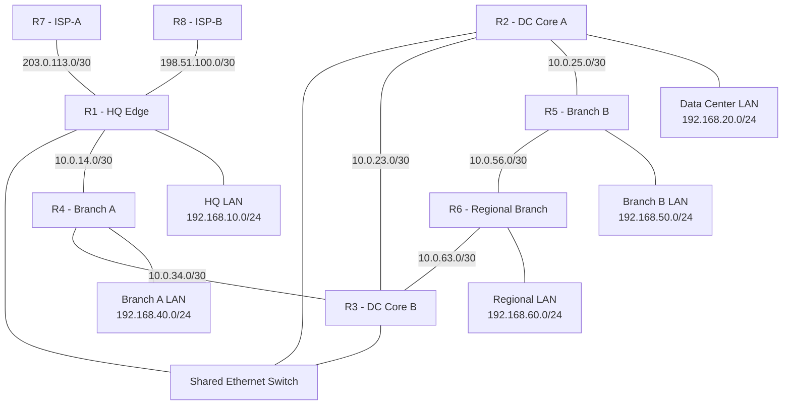

# Enterprise OSPF Routing, Redundancy & Troubleshooting Lab

**Platform:** Cisco Packet Tracer  
**Protocol:** OSPFv2  
**Routing Domain:** Single-area OSPF, Area 0  
**Devices:** 8 Routers, Layer 2 Switches, PCs and Server  
**Level:** CCNA Foundation to Advanced Lab Practice  
**Project Type:** Enterprise Network Engineering Portfolio

---

## 1. Project Overview

This project demonstrates the design, configuration, verification, and troubleshooting of an enterprise IPv4 routing environment using Cisco OSPFv2.

The simulated organization contains a Head Office, Data Center, multiple branch offices, a regional branch, and two simulated ISP routers. The network includes a shared Ethernet segment, redundant internal paths, branch LANs, manually engineered OSPF costs, DR/BDR election, and default-route advertisement.

The project is designed to develop practical networking skills relevant to CCNA certification, Junior NOC Engineer, Network Support Engineer, and Network Operations roles.

### Business Scenario

A company operates its Head Office and Data Center centrally while supporting several remote offices. Each office requires connectivity to internal resources. The network engineering team must ensure that:

- Internal subnets are reachable through dynamic routing.
- Routing decisions are based on OSPF cost rather than simply the number of hops.
- Shared Ethernet networks use appropriate DR/BDR election behavior.
- Branch routers can learn a default route from the enterprise edge.
- Alternative internal paths remain available when a routed link fails.
- Primary and backup static default routes can be evaluated in a simulated dual-ISP design.
- Engineers can diagnose adjacency, route-selection, and connectivity failures using Cisco IOS verification commands.

> **Lab scope:** This is a simulated enterprise network, not a production deployment. The ISP routers represent upstream next hops; they do not automatically provide real Internet connectivity. Actual results must be recorded from the Packet Tracer implementation.

---

## 2. Project Objectives

By completing this project, the learner will practice:

1. Configuring IPv4 addresses, subnet masks, and router interfaces.
2. Configuring OSPFv2 using process IDs, Router IDs, network statements, and wildcard masks.
3. Understanding the difference between OSPF process ID, Router ID, and Area ID.
4. Forming and verifying OSPF neighbor adjacencies.
5. Configuring passive interfaces for user-facing LANs.
6. Understanding DR, BDR, and DROTHER roles on a broadcast Ethernet segment.
7. Configuring OSPF interface priorities and observing election behavior.
8. Calculating cumulative OSPF path costs.
9. Configuring manual interface costs and comparing alternate routes.
10. Understanding automatic cost calculation and reference bandwidth.
11. Examining the relationship between the LSDB, SPF calculation, and routing table.
12. Advertising a default route through OSPF.
13. Comparing OSPF External Type 1 and Type 2 metrics.
14. Testing alternate-path recovery after link failures.
15. Configuring a floating static default route for a simulated backup ISP.
16. Troubleshooting incorrect wildcard masks and passive-interface configuration.
17. Documenting network changes and verification evidence.

---

## 3. Network Architecture

### Router Roles

| Router | Role | Primary responsibility |
|---|---|---|
| R1 | HQ Edge Router | HQ LAN, internal routing, default-route origination, simulated ISP connections |
| R2 | Data Center Core A | Data Center LAN, shared Ethernet, routed links to R3 and R5 |
| R3 | Data Center Core B | Shared Ethernet, core routing, alternate paths to R4 and R6 |
| R4 | Branch A Router | Branch A LAN and alternate connectivity between R1 and R3 |
| R5 | Branch B Router | Branch B LAN and connectivity between R2 and R6 |
| R6 | Regional Branch Router | Regional LAN and connectivity to R3 and R5 |
| R7 | ISP-A Router | Simulated primary upstream next hop |
| R8 | ISP-B Router | Simulated backup upstream next hop |

### Logical Topology



**Important:** The shared Ethernet segment is `10.0.123.0/24`. R1, R2, and R3 connect to the same Layer 2 switch on this subnet. The R1–R4 and R4–R3 connections are separate routed links.

All internal OSPF links and LAN advertisements in the baseline design belong to Area 0.

---

## 4. Addressing Plan

### 4.1 Shared Ethernet Segment

| Device | Interface | IPv4 address | Subnet mask |
|---|---|---|---|
| R1 | G0/1 | 10.0.123.1 | 255.255.255.0 |
| R2 | G0/0 | 10.0.123.2 | 255.255.255.0 |
| R3 | G0/0 | 10.0.123.3 | 255.255.255.0 |

Network: `10.0.123.0/24`

This segment is used to investigate broadcast-network OSPF behavior and DR/BDR election.

### 4.2 Internal Routed Links

| Link | Device interface | IPv4 address | Subnet |
|---|---|---|---|
| R1–R4 | R1 G0/2 | 10.0.14.1/30 | 10.0.14.0/30 |
| R1–R4 | R4 G0/0 | 10.0.14.2/30 | 10.0.14.0/30 |
| R4–R3 | R4 G0/1 | 10.0.34.1/30 | 10.0.34.0/30 |
| R4–R3 | R3 G0/2 | 10.0.34.2/30 | 10.0.34.0/30 |
| R2–R5 | R2 G0/1 | 10.0.25.1/30 | 10.0.25.0/30 |
| R2–R5 | R5 G0/0 | 10.0.25.2/30 | 10.0.25.0/30 |
| R5–R6 | R5 G0/1 | 10.0.56.1/30 | 10.0.56.0/30 |
| R5–R6 | R6 G0/0 | 10.0.56.2/30 | 10.0.56.0/30 |
| R6–R3 | R6 G0/1 | 10.0.63.1/30 | 10.0.63.0/30 |
| R6–R3 | R3 G0/1 | 10.0.63.2/30 | 10.0.63.0/30 |
| R2–R3 | R2 G0/2 | 10.0.23.1/30 | 10.0.23.0/30 |
| R2–R3 | R3 G0/3 | 10.0.23.2/30 | 10.0.23.0/30 |

### 4.3 Enterprise LANs

| Location | Router interface | Gateway | Network |
|---|---|---|---|
| HQ | R1 G0/0 | 192.168.10.1 | 192.168.10.0/24 |
| Data Center | R2 G0/3 | 192.168.20.1 | 192.168.20.0/24 |
| Branch A | R4 G0/3 | 192.168.40.1 | 192.168.40.0/24 |
| Branch B | R5 G0/2 | 192.168.50.1 | 192.168.50.0/24 |
| Regional Branch | R6 G0/2 | 192.168.60.1 | 192.168.60.0/24 |

### 4.4 Simulated ISP Links

| Link | Device interface | IPv4 address | Network |
|---|---|---|---|
| R1–R7 | R1 G0/3 | 203.0.113.1/30 | 203.0.113.0/30 |
| R1–R7 | R7 G0/0 | 203.0.113.2/30 | 203.0.113.0/30 |
| R1–R8 | R1 G0/4 | 198.51.100.1/30 | 198.51.100.0/30 |
| R1–R8 | R8 G0/0 | 198.51.100.2/30 | 198.51.100.0/30 |

The IPv4 ranges `203.0.113.0/24` and `198.51.100.0/24` are reserved for documentation. They are suitable for this simulation but are not real Internet service addresses.

### 4.5 PC Addressing

| PC | IPv4 address | Default gateway |
|---|---|---|
| HQ-PC | 192.168.10.10/24 | 192.168.10.1 |
| DC-PC | 192.168.20.10/24 | 192.168.20.1 |
| Branch-A-PC | 192.168.40.10/24 | 192.168.40.1 |
| Branch-B-PC | 192.168.50.10/24 | 192.168.50.1 |
| Regional-PC | 192.168.60.10/24 | 192.168.60.1 |

---

## 5. Physical Implementation Requirements

Required devices:

- 8 Cisco routers with sufficient Ethernet interfaces.
- 1 Layer 2 switch for the shared Ethernet segment.
- Access switches for user LANs as needed.
- PCs for each user LAN.
- Optional Data Center server.

Interface names in this repository are logical labels. The actual interface names depend on the router model and installed modules in Packet Tracer.

R1 requires five logical interfaces in the baseline design. If the selected model does not provide enough ports, install a compatible module or redesign the connections and addressing before applying the configuration.

### Initial Interface Verification

Run on each router:

```cisco
show ip interface brief
show interfaces description
```

Before configuring OSPF, verify that each connected interface has the intended address and is operational.

Test directly connected neighbors with `ping`.

Do not proceed to routing verification until addressing and physical connectivity are correct.

---

## 6. OSPFv2 Design

### 6.1 Router IDs

| Router | Router ID | Process ID |
|---|---|---:|
| R1 | 10.255.255.1 | 10 |
| R2 | 10.255.255.2 | 20 |
| R3 | 10.255.255.3 | 30 |
| R4 | 10.255.255.4 | 40 |
| R5 | 10.255.255.5 | 50 |
| R6 | 10.255.255.6 | 60 |

The Router ID is a 32-bit identifier represented in dotted-decimal format. Explicit unique Router IDs make neighbor and LSDB analysis easier.

OSPF process IDs are locally significant on Cisco routers. Different process IDs do not inherently prevent adjacency.

### 6.2 Wildcard Masks

| Network prefix | Subnet mask | Wildcard mask |
|---|---|---|
| /24 | 255.255.255.0 | 0.0.0.255 |
| /30 | 255.255.255.252 | 0.0.0.3 |
| Exact host match | 255.255.255.255 | 0.0.0.0 |

An OSPF `network` statement matches local interface addresses. It enables OSPF on matching interfaces and associates those interfaces with the specified area; it does not directly mean that an arbitrary remote network is advertised.

### 6.3 OSPF Area

All internal enterprise interfaces in this baseline design use **Area 0**.

This is a single-area design. It does not demonstrate ABR-based multi-area routing or area summarization.

---

## 7. Configuration Files

Save the final configurations in the `configs/` directory.

### R1 — HQ Edge Router

```cisco
hostname R1

interface GigabitEthernet0/0
 description HQ_USER_LAN
 ip address 192.168.10.1 255.255.255.0
 no shutdown

interface GigabitEthernet0/1
 description SHARED_OSPF_ETHERNET
 ip address 10.0.123.1 255.255.255.0
 ip ospf priority 200
 ip ospf cost 10
 no shutdown

interface GigabitEthernet0/2
 description WAN_TO_R4
 ip address 10.0.14.1 255.255.255.252
 ip ospf cost 50
 no shutdown

interface GigabitEthernet0/3
 description PRIMARY_ISP_R7
 ip address 203.0.113.1 255.255.255.252
 no shutdown

interface GigabitEthernet0/4
 description BACKUP_ISP_R8
 ip address 198.51.100.1 255.255.255.252
 no shutdown

router ospf 10
 router-id 10.255.255.1
 network 192.168.10.0 0.0.0.255 area 0
 network 10.0.123.0 0.0.0.255 area 0
 network 10.0.14.0 0.0.0.3 area 0
 passive-interface GigabitEthernet0/0
 default-information originate

ip route 0.0.0.0 0.0.0.0 203.0.113.2
ip route 0.0.0.0 0.0.0.0 198.51.100.2 10
```

The primary default route has a lower administrative distance than the floating static backup route. The backup route is intended to become active if the primary route is removed from the routing table and the backup next hop remains usable.

### R2 — Data Center Core A

```cisco
hostname R2

interface GigabitEthernet0/0
 description SHARED_OSPF_ETHERNET
 ip address 10.0.123.2 255.255.255.0
 ip ospf priority 100
 no shutdown

interface GigabitEthernet0/1
 description WAN_TO_R5
 ip address 10.0.25.1 255.255.255.252
 no shutdown

interface GigabitEthernet0/2
 description DIRECT_LINK_TO_R3
 ip address 10.0.23.1 255.255.255.252
 no shutdown

interface GigabitEthernet0/3
 description DATA_CENTER_LAN
 ip address 192.168.20.1 255.255.255.0
 no shutdown

router ospf 20
 router-id 10.255.255.2
 network 10.0.123.0 0.0.0.255 area 0
 network 10.0.25.0 0.0.0.3 area 0
 network 10.0.23.0 0.0.0.3 area 0
 network 192.168.20.0 0.0.0.255 area 0
 passive-interface GigabitEthernet0/3
```

### R3 — Data Center Core B

```cisco
hostname R3

interface GigabitEthernet0/0
 description SHARED_OSPF_ETHERNET
 ip address 10.0.123.3 255.255.255.0
 ip ospf priority 50
 ip ospf cost 10
 no shutdown

interface GigabitEthernet0/1
 description WAN_TO_R6
 ip address 10.0.63.2 255.255.255.252
 no shutdown

interface GigabitEthernet0/2
 description WAN_TO_R4
 ip address 10.0.34.2 255.255.255.252
 ip ospf cost 10
 no shutdown

interface GigabitEthernet0/3
 description DIRECT_LINK_TO_R2
 ip address 10.0.23.2 255.255.255.252
 no shutdown

router ospf 30
 router-id 10.255.255.3
 network 10.0.123.0 0.0.0.255 area 0
 network 10.0.34.0 0.0.0.3 area 0
 network 10.0.63.0 0.0.0.3 area 0
 network 10.0.23.0 0.0.0.3 area 0
```

### R4 — Branch A

```cisco
hostname R4

interface GigabitEthernet0/0
 description WAN_TO_R1
 ip address 10.0.14.2 255.255.255.252
 ip ospf cost 10
 no shutdown

interface GigabitEthernet0/1
 description WAN_TO_R3
 ip address 10.0.34.1 255.255.255.252
 ip ospf cost 10
 no shutdown

interface GigabitEthernet0/3
 description BRANCH_A_LAN
 ip address 192.168.40.1 255.255.255.0
 no shutdown

router ospf 40
 router-id 10.255.255.4
 network 10.0.14.0 0.0.0.3 area 0
 network 10.0.34.0 0.0.0.3 area 0
 network 192.168.40.0 0.0.0.255 area 0
 passive-interface GigabitEthernet0/3
```

### R5 — Branch B

```cisco
hostname R5

interface GigabitEthernet0/0
 description WAN_TO_R2
 ip address 10.0.25.2 255.255.255.252
 no shutdown

interface GigabitEthernet0/1
 description WAN_TO_R6
 ip address 10.0.56.1 255.255.255.252
 no shutdown

interface GigabitEthernet0/2
 description BRANCH_B_LAN
 ip address 192.168.50.1 255.255.255.0
 no shutdown

router ospf 50
 router-id 10.255.255.5
 network 10.0.25.0 0.0.0.3 area 0
 network 10.0.56.0 0.0.0.3 area 0
 network 192.168.50.0 0.0.0.255 area 0
 passive-interface GigabitEthernet0/2
```

### R6 — Regional Branch

```cisco
hostname R6

interface GigabitEthernet0/0
 description WAN_TO_R5
 ip address 10.0.56.2 255.255.255.252
 no shutdown

interface GigabitEthernet0/1
 description WAN_TO_R3
 ip address 10.0.63.1 255.255.255.252
 no shutdown

interface GigabitEthernet0/2
 description REGIONAL_LAN
 ip address 192.168.60.1 255.255.255.0
 no shutdown

router ospf 60
 router-id 10.255.255.6
 network 10.0.56.0 0.0.0.3 area 0
 network 10.0.63.0 0.0.0.3 area 0
 network 192.168.60.0 0.0.0.255 area 0
 passive-interface GigabitEthernet0/2
```

### R7 — Simulated Primary ISP

```cisco
hostname R7

interface GigabitEthernet0/0
 description TO_ENTERPRISE_R1
 ip address 203.0.113.2 255.255.255.252
 no shutdown
```

### R8 — Simulated Backup ISP

```cisco
hostname R8

interface GigabitEthernet0/0
 description TO_ENTERPRISE_R1
 ip address 198.51.100.2 255.255.255.252
 no shutdown
```

**Configuration note:** These are baseline configuration templates. Adjust interface identifiers to match the Packet Tracer router model. The optional manual cost and DR/BDR settings are intentional lab parameters; they are not claims about actual measured link performance.

---

## 8. DR/BDR Election

The shared Ethernet segment is used to study OSPF DR/BDR behavior.

### Planned Interface Priorities

| Router | Interface | Priority | Expected role at initial election |
|---|---|---:|---|
| R1 | G0/1 | 200 | DR |
| R2 | G0/0 | 100 | BDR |
| R3 | G0/0 | 50 | DROTHER |

This expected result assumes all three routers participate when the election begins and no other eligible router is present on the segment.

### Concepts Demonstrated

- A priority of 0 prevents an interface from becoming DR or BDR.
- Higher eligible interface priority is preferred during election.
- Router ID breaks a priority tie.
- DR/BDR election is generally non-preemptive.
- A DR is not automatically the preferred data-forwarding path.
- On a broadcast network, DROTHER routers normally form Full adjacencies with the DR and BDR; DROTHER-to-DROTHER relationships generally remain 2-Way.

### Verification

```cisco
show ip ospf neighbor
show ip ospf interface GigabitEthernet0/1
show ip ospf interface GigabitEthernet0/0
```

Record the actual DR, BDR, priority, and neighbor states in the results section.

---

## 9. OSPF Cost and Best-Path Selection

OSPF calculates paths using cumulative interface cost. It does not simply select the path with the fewest router hops.

### Manual Cost Configuration

The baseline design assigns selected interface costs to create a predictable comparison.

| Interface | Configured cost |
|---|---:|
| R1 G0/1 — shared Ethernet | 10 |
| R3 G0/0 — shared Ethernet | 10 |
| R1 G0/2 — R4 path | 50 |
| R4 G0/0 — R1 link | 10 |
| R4 G0/1 — R3 link | 10 |
| R3 G0/2 — R4 link | 10 |

For traffic from R1 to R3, the shared segment is expected to be cheaper than the path through R4 under these settings.

However, the route to a LAN behind R3 may have a different total cost because the outgoing interface cost on the final routed hop must also be considered.

### Automatic Cost Calculation

Cisco IOS commonly calculates OSPF cost using:

`OSPF cost = reference bandwidth / interface bandwidth`

The default reference bandwidth is commonly 100 Mbps. Consequently, higher-speed interfaces can receive the same minimum cost unless the reference bandwidth is adjusted.

An example configuration is:

```cisco
router ospf 10
 auto-cost reference-bandwidth 10000
```

The value `10000` represents 10,000 Mbps.

Use a consistent reference bandwidth across the internal OSPF domain when relying on automatic cost calculation. An explicit `ip ospf cost` configuration overrides the automatically calculated cost for that interface.

### Equal-Cost Multipath

If multiple paths to a destination have the same OSPF cost, OSPF may install multiple equal-cost routes, subject to platform limits and routing configuration.

### Verification

```cisco
show ip ospf interface
show ip route ospf
show ip route 192.168.20.0
show ip route 192.168.40.0
show ip route 192.168.50.0
show ip route 192.168.60.0
traceroute 192.168.20.10
```

Record the actual next hop and metric for each tested destination.

---

## 10. Default Route Advertisement

R1 is the simulated enterprise edge router.

### Static Default Routes

```cisco
ip route 0.0.0.0 0.0.0.0 203.0.113.2
ip route 0.0.0.0 0.0.0.0 198.51.100.2 10
```

The first route uses the default administrative distance for a static route. The second has administrative distance 10 and acts as a floating static route while the primary route is installed.

### OSPF Default Origination

```cisco
router ospf 10
 default-information originate
```

With the normal conditional behavior, R1 originates a default route when a usable default route is present in its routing table.

### Verification

On R1:

```cisco
show ip route 0.0.0.0
show ip protocols
```

On R2, R3, R4, R5, and R6:

```cisco
show ip route 0.0.0.0
show ip route
show ip ospf database external
```

The internal routers should learn an OSPF external default route when origination is working correctly.

### `default-information originate always`

The `always` option can originate a default even if the originating router does not have a default route installed.

This can be useful in specific designs, but it can also cause traffic to be directed toward a router with no working upstream path. Do not use it in the baseline configuration.

### E1 and E2

OSPF external Type 1 and Type 2 routes use different metric-comparison behavior.

- **E1:** The external metric and internal cost to the ASBR contribute to the total metric.
- **E2:** The external metric is the primary comparison metric; internal cost is used for tie-breaking and related path-selection rules.

An optional experiment is:

```cisco
router ospf 10
 default-information originate metric-type 1
```

A meaningful E1/E2 comparison requires suitable competing external routes or ASBRs. One default route from one edge router alone does not fully demonstrate the difference.

---

## 11. Failure Simulation and Troubleshooting

Run each test separately. Record the baseline state, inject one fault, observe the result, restore the link or configuration, and verify recovery.

### Test A — Shared Ethernet Failure

On R1:

```cisco
configure terminal
interface GigabitEthernet0/1
 shutdown
end
```

Verification:

```cisco
show ip ospf neighbor
show ip route 192.168.20.0
show ip route 192.168.40.0
traceroute 192.168.20.10
```

Expected behavior:

- R1 loses its shared-segment OSPF adjacencies.
- R2 and R3 can remain adjacent to each other because their switch connections are still operational.
- Alternative routing through R4 may provide reachability to destinations behind R3 if the relevant paths and metrics permit it.

Restore:

```cisco
configure terminal
interface GigabitEthernet0/1
 no shutdown
end
```

### Test B — R4-to-R3 WAN Failure

On R4:

```cisco
configure terminal
interface GigabitEthernet0/1
 shutdown
end
```

Verification:

```cisco
show ip ospf neighbor
show ip route 192.168.20.0
show ip route 192.168.60.0
```

Restore:

```cisco
interface GigabitEthernet0/1
 no shutdown
```

Compare the routes before and after the failure.

### Test C — Primary ISP Interface Failure

On R1:

```cisco
configure terminal
interface GigabitEthernet0/3
 shutdown
end
```

Verification:

```cisco
show ip route 0.0.0.0
show ip route
```

If the primary static default route is removed and the backup next hop remains usable, the floating static default route may become active.

Restore:

```cisco
interface GigabitEthernet0/3
 no shutdown
```

**Important limitation:** Shutting down the primary-facing interface is not the same as an upstream ISP service failure. If the interface remains up while the ISP loses upstream connectivity, a simple static route may remain installed. Production designs commonly require upstream health checking, such as IP SLA and object tracking, or an appropriate dynamic-routing design.

### Test D — Incorrect Wildcard Mask

On R4:

```cisco
router ospf 40
 no network 10.0.14.0 0.0.0.3 area 0
 network 10.0.14.0 0.0.0.0 area 0
```

The exact-match wildcard does not match R4's `10.0.14.2` interface address. The R1–R4 OSPF adjacency should therefore fail to form or recover while the incorrect statement is in effect.

Restore the correct statement:

```cisco
router ospf 40
 no network 10.0.14.0 0.0.0.0 area 0
 network 10.0.14.0 0.0.0.3 area 0
```

Verify:

```cisco
show ip ospf interface brief
show ip ospf neighbor
show ip route ospf
```

### Test E — Passive Transit Interface

On R4:

```cisco
router ospf 40
 passive-interface GigabitEthernet0/0
```

OSPF Hello packets are suppressed on that interface, preventing the expected adjacency from forming.

Restore:

```cisco
router ospf 40
 no passive-interface GigabitEthernet0/0
```

Verify the neighbor state again.

---

## 12. OSPF Verification Command Reference

| Command | Purpose |
|---|---|
| `show ip interface brief` | Interface state and addressing |
| `show interfaces description` | Interface descriptions |
| `show ip ospf` | OSPF process information |
| `show ip ospf neighbor` | Neighbor states and DR/BDR roles |
| `show ip ospf interface` | Interface cost, priority, timers, and network type |
| `show ip ospf interface brief` | Summary of OSPF-enabled interfaces |
| `show ip ospf database` | Link-State Database |
| `show ip ospf database router` | Router LSAs |
| `show ip ospf database network` | Network LSAs |
| `show ip ospf database external` | External LSAs, including default-route information |
| `show ip route` | Routing table |
| `show ip route ospf` | OSPF-learned routes |
| `show ip protocols` | Routing protocol configuration and parameters |
| `show running-config` | Active configuration |
| `ping <destination>` | Basic reachability test |
| `traceroute <destination>` | Forwarding-path investigation |

Commands and output details may vary by IOS image and Packet Tracer device model.

---

## 13. Acceptance Test Checklist

Mark a test complete only after it has been performed and verified.

- [ ] All required interfaces have correct IPv4 addresses and are operational.
- [ ] All intended internal OSPF adjacencies form successfully.
- [ ] Router IDs are unique.
- [ ] Process IDs and area assignments are understood and documented.
- [ ] User LANs are advertised through passive interfaces.
- [ ] Shared Ethernet DR/BDR election is verified.
- [ ] OSPF costs are inspected and documented.
- [ ] Route selection is verified for internal destinations.
- [ ] Default-route origination is verified.
- [ ] E1/E2 behavior is tested if the optional experiment is completed.
- [ ] Shared Ethernet failure is tested.
- [ ] Routed WAN failure is tested.
- [ ] Primary and floating static default routes are tested.
- [ ] Wildcard-mask troubleshooting is completed.
- [ ] Passive-interface troubleshooting is completed.
- [ ] End-to-end PC connectivity is tested.
- [ ] Screenshots and relevant command outputs are saved.
- [ ] Final router configurations are saved.
- [ ] The final Packet Tracer file is saved and reopened successfully.

---

## 14. Results and Evidence

Replace the placeholders below with actual results from your implementation.

| Test | Expected behavior | Actual result |
|---|---|---|
| OSPF neighbor formation | Intended adjacencies reach the appropriate state | Pending verification |
| DR/BDR election | R1/R2/R3 roles match the controlled-election conditions | Pending verification |
| Cost-based routing | Selected route matches the configured metric and topology | Pending verification |
| Default-route origination | Internal routers learn the default route | Pending verification |
| Shared Ethernet failure | Alternate path is used when eligible and reachable | Pending verification |
| WAN failure | Routing reconverges where an alternate path exists | Pending verification |
| Primary ISP failure | Backup static route activates when the primary route is removed | Pending verification |
| Wildcard-mask fault | Incorrect interface matching is identified and corrected | Pending verification |
| Passive-interface fault | Missing adjacency is identified and corrected | Pending verification |

### Recommended Screenshots

Save evidence in `screenshots/`:

- `ospf-neighbors.png`
- `dr-bdr-election.png`
- `routing-table.png`
- `default-route.png`
- `shared-link-failure.png`
- `isp-failover.png`
- `wildcard-troubleshooting.png`

Do not label a test as successful until its result has been observed.

---

 
## 15. Skills Demonstrated

- IPv4 addressing and subnetting
- Cisco IOS configuration
- OSPFv2 single-area routing
- Router ID and wildcard-mask configuration
- OSPF neighbor-state analysis
- Passive-interface configuration
- DR/BDR election
- OSPF metric and best-path analysis
- Default-route origination
- External route metric concepts
- Floating static routes
- Routing convergence and fault isolation
- Packet Tracer simulation
- Network documentation and Git-based portfolio management

---

 
 
## 16. Learning Outcomes

After completing and documenting the lab, you should be able to explain:

1. How OSPF discovers neighbors and establishes adjacencies.
2. Why Router ID and process ID serve different purposes.
3. How wildcard masks determine which local interfaces participate in OSPF.
4. Why DR/BDR election is separate from route selection.
5. How cumulative OSPF cost determines the preferred route.
6. How automatic interface cost differs from manually configured cost.
7. How OSPF distributes a default route to internal routers.
8. Why default-route advertisement does not itself guarantee Internet access.
9. How routing changes when an interface or routed link fails.
10. How to use verification commands to identify and resolve common OSPF problems.

---

 

## 17. Final Project Status

**Project status:** Lab design and configuration template prepared.

The project should be marked **Completed** only after the topology is implemented, the required configurations are applied, the acceptance tests are executed, and the final evidence is committed to the repository.

**Final goal:** Build a working OSPF lab that you can explain, troubleshoot, demonstrate, and confidently discuss in a networking interview.
